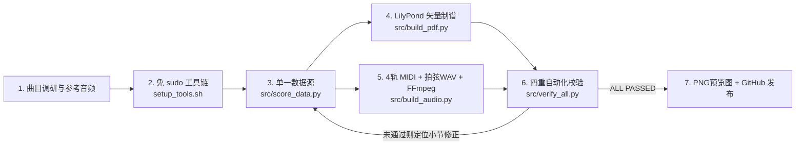
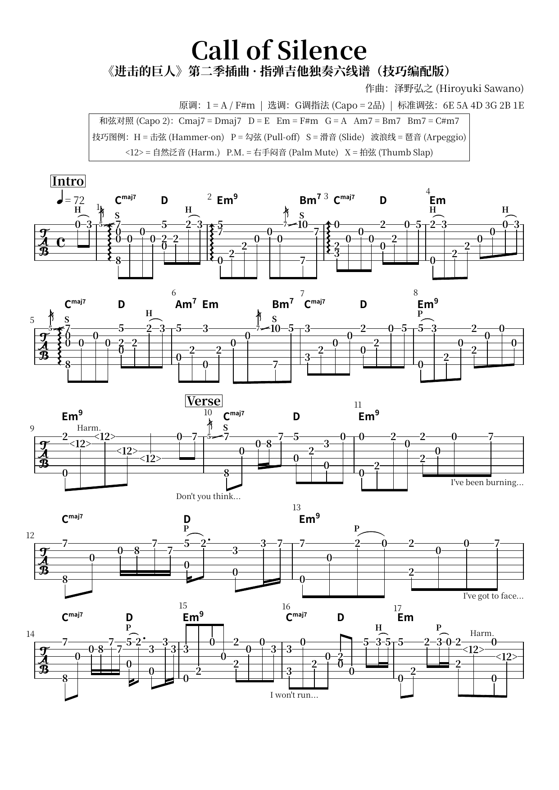
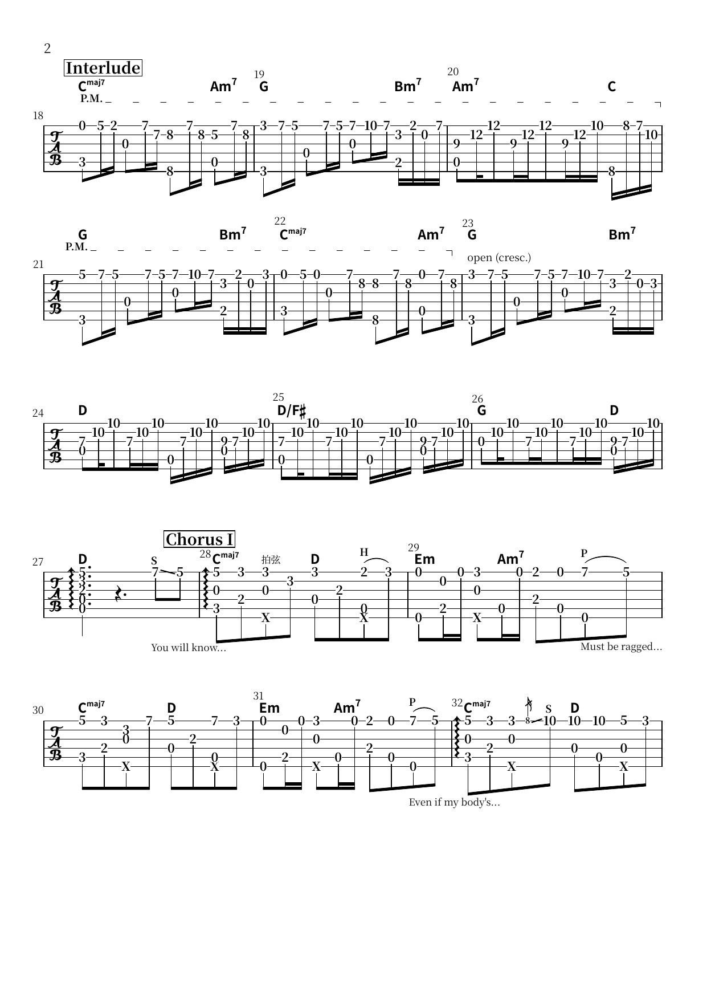
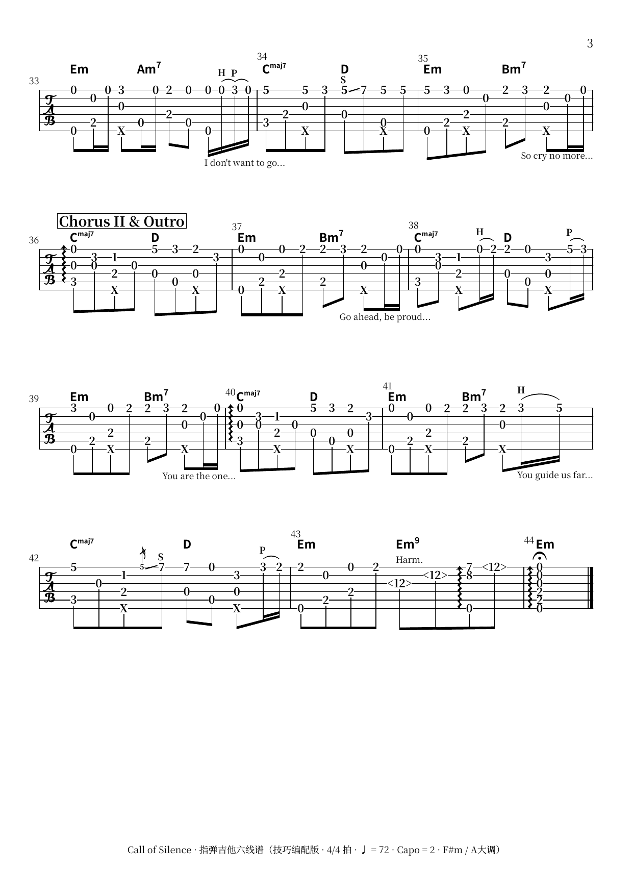

# Fingerstyle Guitar TAB Skill (`fingerstyle-guitar-tab`)

> 一套可跨 AI Agent 复现的指弹吉他**六线谱矢量 PDF + 拟真试听 MP3** 工程化工作流 Skill，内置《Call of Silence》（《进击的巨人》第二季插曲）完整源码与免下载在线看谱试听页面。

> **[▶️ 点此直接在线试听 + 无分页连续滚屏看谱（支持无遮挡逐拍染色聚焦、自动换行居中滚动、点谱任意小节即播、以及 `📂 导入 Skill 产物` 本地试听）](https://zxsos.github.io/fingerstyle-guitar-tab-skill/)**

核心架构为 **Single Source of Truth（单一数据源）**：同一份 Python 乐谱模型（`score_data.py`）同时驱动 GNU LilyPond 矢量六线谱排版与 FluidSynth + FFmpeg 音频合成，从根源上避免“谱面品格与试听音高错位”的问题，并通过自动化脱敏、声学与指法校验门禁把关。



---

## 最终作品展示：《Call of Silence》指弹吉他独奏（技巧编配版）

### 成品文件与在线直览

- **🌐 免下载在线看谱 + 同步试听页**：[https://zxsos.github.io/fingerstyle-guitar-tab-skill/](https://zxsos.github.io/fingerstyle-guitar-tab-skill/)（无分页连续滚动白底纸张、无遮挡歌词级逐拍染色聚焦、60fps 游标、点谱任意小节即播、0.5x/0.75x 变速练琴，并支持直接拖拽导入其他曲目的 Skill 生成产物）
- **📄 高清矢量六线谱 PDF**：[Call_of_Silence_指弹吉他六线谱.pdf](examples/call-of-silence/Call_of_Silence_指弹吉他六线谱.pdf)（A4 · 3 页 · 已脱敏 0 本地路径泄漏）
- **🎵 拟真指弹试听 MP3**：[Call_of_Silence_指弹吉他试听.mp3](examples/call-of-silence/Call_of_Silence_指弹吉他试听.mp3)（44.1 kHz · 320 kbps 立体声 · 151.80 s）
- **💻 完整可复现源码**：[examples/call-of-silence/src/](examples/call-of-silence/src/)

### 核心指标

| 项目 | 规格与实测结果 |
| :--- | :--- |
| 曲目 / 调式 | 原调 `1 = A / F#m`，标准调弦（`6E 5A 4D 3G 2B 1E`）+ `Capo = 2`（G / Em 指法） |
| 拍号 / 速度 | `4/4` 拍，`72 BPM`（尾小节渐慢至 60 BPM），45 小节（`M00` 弱起 + `M01..M44`） |
| 音符与技巧密度 | 602 个音符/拍弦事件；覆盖 `H`(10)、`P`(10)、`S`(9)、`Arpeggio`(11)、`<12> Harm.`(9)、`P.M.`(20)、`Slap X`(27) |
| 指法可弹度 | 单手同步按弦跨度全部 `<= 3` 品，100% 落在 A 大调 / F# 小调自然音阶内 |
| 隐私与安全脱敏 | 已启用 `\pointAndClickOff` + `-dno-point-and-click` 与 `-map_metadata -1`，PDF 内部 `0` 条本地工作路径泄漏 |
| 音频质量 | 峰值 `-1.46 dBFS`，左右声道差 `0.79 dB`，立体声相位相关度 `0.986`，调内能量占比 `95.2%` |

### 谱面高清全览（直接在页面阅读，无需下载 PDF）

> 提示：如需边听边看、点击放大或使用 0.5x 慢速练琴，请直接打开 **[在线试听看谱页面](https://zxsos.github.io/fingerstyle-guitar-tab-skill/)**。

#### 第 1 页（Intro M00–M09 + Verse M10–M17）



#### 第 2 页（Interlude P.M. M18–M27 + Chorus I 前半 M28–M32）



#### 第 3 页（Chorus I 尾段 M33–M35 + Chorus II M36–M44）



### 自动化验证输出（`verify_all.py`）

```text
[PASS] Score integrity: 45 measures (M00..M44), 602 notes/slaps, fret span <= 3, 100% A/F#m diatonic, techniques={'H': 10, 'P': 10, 'S': 9, 'arpeggio': 11, 'harmonic': 9, 'palm_mute': 20, 'slap': 27}.
[PASS] PDF verified: Call_of_Silence_指弹吉他六线谱.pdf (3,065,153 bytes, 3 pages, sanitized (0 path leaks)).
[PASS] MP3 audio verified: 151.80s, 44100 Hz, 2ch, 320 kbps, peak -1.46 dBFS, L/R diff 0.79 dB, phase corr 0.986, diatonic share 95.2%.
[SKIP] Gate 4 (reference alignment): pass --ref <audio_path_or_url> or set TAB_REF_AUDIO to enable.

ALL VERIFICATION CHECKS PASSED.
```

> 如需运行第 4 道外部参考音频色度对齐门禁，可在本地执行：
> `python3 examples/call-of-silence/src/verify_all.py --ref <本地参考音频路径或URL>`（或设置环境变量 `TAB_REF_AUDIO`）。

---

## 作为 Agent Skill 安装

本仓库严格遵循 [Agent Skills Specification](https://agentskills.io/specification)，Skill 目录位于 [skills/fingerstyle-guitar-tab/](skills/fingerstyle-guitar-tab/)。

### 方式一：使用 Skills CLI（推荐）

```bash
npx skills add zxsos/fingerstyle-guitar-tab-skill
```

### 方式二：手动复制到各 Agent 全局 / 工作区目录

```bash
git clone https://github.com/zxsos/fingerstyle-guitar-tab-skill.git
cd fingerstyle-guitar-tab-skill

# Antigravity / Codex / Gemini CLI（全局通用目录）
mkdir -p ~/.agents/skills
cp -r skills/fingerstyle-guitar-tab ~/.agents/skills/

# Claude Code（个人 Skill 目录）
mkdir -p ~/.claude/skills
cp -r skills/fingerstyle-guitar-tab ~/.claude/skills/

# 或仅放入当前项目工作区（跨团队共享）
mkdir -p .agents/skills
cp -r skills/fingerstyle-guitar-tab .agents/skills/
```

---

## 给其他 AI 的一键复现提示词（可直接复制转发）

把下面这段话连同本仓库地址发给任意具备终端能力的 AI Agent，它就能从零复现当前作品或帮你编配新曲并发布到 GitHub：

```text
请先克隆仓库 https://github.com/zxsos/fingerstyle-guitar-tab-skill ，
并阅读 skills/fingerstyle-guitar-tab/SKILL.md 以及 skills/fingerstyle-guitar-tab/references/ 下的全部文档。

任务要求：
1. 在 Debian/Ubuntu 环境下先运行 `bash skills/fingerstyle-guitar-tab/scripts/setup_tools.sh` 免 sudo 安装本地 LilyPond / FluidSynth / FluidR3_GM.sf2 工具链，并确认系统存在 python3、ffmpeg、ffprobe、gs、pdftoppm。
2. 先运行 `examples/call-of-silence/src/` 下的 `build_pdf.py`、`build_audio.py` 和 `verify_all.py`，确保看到 `ALL VERIFICATION CHECKS PASSED.`（如有参考音频，可额外传入 `--ref <参考音频路径或URL>`）。
3. 若我要编配新曲目《<填入曲名>》：严格参考 `examples/call-of-silence/src/` 的 Single Source of Truth 架构，新建项目目录编写 `src/score_data.py`、`src/build_pdf.py`、`src/build_audio.py`、`src/verify_all.py`，确保通过全部验证门槛（音阶纯净度 > 85%、峰值 < -1 dBFS、PDF 无本地路径泄漏，禁止在代码里硬编码第三方抓取链接）。
4. 使用 `pdftoppm -png -r 150` 导出 PDF 预览图并运行 `src/build_sync_manifest.py` 生成 `sync_manifest.json`（用户可直接拖入 `https://zxsos.github.io/fingerstyle-guitar-tab-skill/` 的 `📂 导入 Skill 产物` 即刻无分页连续滚屏试听），检查 `.gitignore` 确保不提交 `.tools/` 和 `.wav/.mid/.ly` 中间文件，然后提交并推送到 GitHub 仓库开启 GitHub Pages 展示。
```

---

## 完整复现与发布指南（分步说明）

### 1. 环境准备（免 `sudo` 安装工具链）

系统需预装基础命令行工具：`python3`、`ffmpeg`、`ffprobe`、`gs`（Ghostscript）、`pdftoppm`（`poppler-utils`），以及中文字体（`Noto Serif CJK SC` / `Noto Sans CJK SC`）。

```bash
git clone https://github.com/zxsos/fingerstyle-guitar-tab-skill.git
cd fingerstyle-guitar-tab-skill

# 在当前仓库根目录免 sudo 下载并解压 .tools/root（已被 .gitignore 忽略）
bash skills/fingerstyle-guitar-tab/scripts/setup_tools.sh
```

> **macOS 用户**：运行 `brew install lilypond fluid-synth ffmpeg ghostscript poppler`，并将 `FluidR3_GM.sf2` 放入 `/opt/homebrew/share/soundfonts/`（或设置 `export TAB_SF2_PATH=...`）。

### 2. 从源码重新生成《Call of Silence》并校验

`build_pdf.py` 与 `build_audio.py` 会自动按顺序检索 `$TAB_TOOLS_ROOT`、项目内 `.tools/root`、仓库根目录 `.tools/root` 以及系统 `PATH`：

```bash
python3 examples/call-of-silence/src/build_pdf.py
python3 examples/call-of-silence/src/build_audio.py
python3 examples/call-of-silence/src/verify_all.py
python3 examples/call-of-silence/src/build_sync_manifest.py
```

> **直接拖入新曲产物试听**：任何遵循本 Skill 生成的本地项目目录（包含 `*.mp3` + `previews/page-*.png`，以及可选的 `sync_manifest.json` / `src/score_data.py` / `*.pdf`），都可以直接拖入 **[在线播放器](https://zxsos.github.io/fingerstyle-guitar-tab-skill/)** 右上角的 **`📂 导入 Skill 产物`**，纯浏览器本地自动识谱、无缝切片、逐拍染色播放并支持导出 `sync_manifest.json`。

### 3. 编配新曲目的核心工程约定

详细规范见 Skill 目录中的参考手册：

- **乐谱数据模型与校验规则**：[skills/fingerstyle-guitar-tab/references/score-schema.md](skills/fingerstyle-guitar-tab/references/score-schema.md)
  - 用 `written_midi`（不含 Capo）生成六线谱品格，用 `concert_midi`（含 Capo）合成音频，杜绝变调夹换算错位。
- **LilyPond 6 线谱排版规范**：[skills/fingerstyle-guitar-tab/references/lilypond-tab-patterns.md](skills/fingerstyle-guitar-tab/references/lilypond-tab-patterns.md)
  - 启用 `\pointAndClickOff` 与 `-dno-point-and-click` 彻底杜绝 PDF 泄漏本地路径；处理倚音滑弦 `\slashedGrace` 与 `ChordNames` 同步（插入 `\grace { s16 }`）、连续击勾弦 `0h3p0` 括号闭合顺序、`<12>` 泛音与 `X` 拍弦自定义符头、`P.M.` 虚线跨度标记。
- **多轨音频合成与 4 重校验**：[skills/fingerstyle-guitar-tab/references/audio-and-verification.md](skills/fingerstyle-guitar-tab/references/audio-and-verification.md)
  - 4 通道 MIDI（Ch0 钢弦、Ch1 尼龙弦、Ch2 竖琴泛音层、Ch3 闷音吉他）、FluidSynth `-C 0` 与 `CC93=0` 禁用人工合唱走音、WAV 波形层注入 30ms 拇指拍弦冲击、FFmpeg 均衡与 `-16 LUFS` 响度标准化（`-map_metadata -1` 剥离多余元数据）、PDF 0 路径泄漏校验及可选 `--ref` Goertzel 色度对齐校验。

### 4. 生成预览图、同步清单并上传 GitHub 展示

```bash
# 1) 导出 PDF 每页 PNG 预览图，并生成 sync_manifest.json（用于在线播放器无分页连续同步滚动）
mkdir -p previews
pdftoppm -png -r 150 <你的乐谱>.pdf previews/page
python3 src/build_sync_manifest.py

# 2) 确保包含 index.html 与 .nojekyll（实现免下载浏览器直览与试听），且未把 .tools/、build/*.wav、__pycache__/ 纳入版本控制
git status

# 3) 提交并推送到 GitHub，随后在 Settings -> Pages 或通过 gh api 启用 GitHub Pages（main 分支根目录 /）
git add .
git commit -m "feat: add sanitized fingerstyle guitar TAB PDF, MP3 preview, and online player"
gh repo create <your-repo-name> --public --source=. --remote=origin --push
```

---

## 仓库目录结构

```text
fingerstyle-guitar-tab-skill/
├── README.md
├── index.html                                   # GitHub Pages 免下载无分页连续看谱 + 本地产物导入播放器
├── .nojekyll                                    # 禁用 Jekyll，直接静态托管 HTML/PDF/MP3/PNG/JSON
├── LICENSE
├── .gitignore
├── skills/
│   └── fingerstyle-guitar-tab/
│       ├── SKILL.md                             # Skill 核心入口（遵循 Agent Skills 规范）
│       ├── scripts/
│       │   └── setup_tools.sh                   # Linux 免 sudo 工具链一键安装与自检脚本
│       └── references/
│           ├── score-schema.md                  # 单一数据源结构与指法/音阶校验规则
│           ├── lilypond-tab-patterns.md         # LilyPond TabStaff 排版与技巧标记规范
│           └── audio-and-verification.md        # MIDI/FluidSynth/FFmpeg 合成与 4 重验证体系
└── examples/
    └── call-of-silence/
        ├── Call_of_Silence_指弹吉他六线谱.pdf     # 成品矢量六线谱（3 页 A4）
        ├── Call_of_Silence_指弹吉他试听.mp3       # 成品 320 kbps 立体声试听音频
        ├── sync_manifest.json                   # 14 行无遮挡切片 + 45 小节同步时间轴清单
        ├── previews/                            # 展示与切片用 PNG 预览图
        │   ├── page-1.png
        │   ├── page-2.png
        │   └── page-3.png
        └── src/                                 # 完整可运行模板源码
            ├── score_data.py
            ├── build_pdf.py
            ├── build_audio.py
            ├── build_sync_manifest.py
            └── verify_all.py
```

## License

[MIT](LICENSE)
