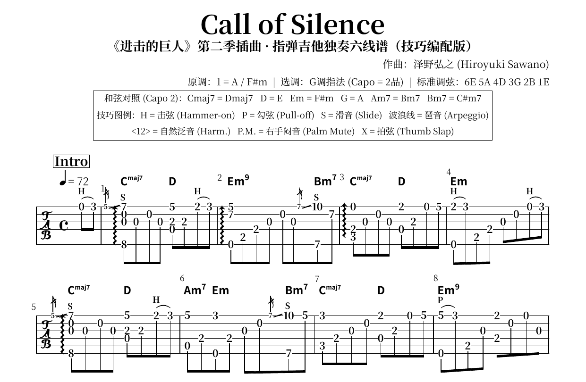

<div align="center">

# Fingerstyle Guitar TAB

一个 Agent Skill：把一首歌编配成指弹吉他六线谱 PDF 与同步试听 MP3。

[在线练习播放器](https://zxsos.github.io/guitar-tab-player/) · [播放器仓库](https://github.com/zxsos/guitar-tab-player) · [安装](#安装) · [快速开始](#快速开始)

<a href="https://zxsos.github.io/guitar-tab-player/"></a>

</div>

## 特性

- **单一数据源** — 一份 `score_data.py` 同时生成 PDF 与音频，品格与音高不会错位
- **完整指弹技巧** — 击弦、勾弦、滑音、琶音、泛音、闷音、拍弦
- **自动校验** — 指法跨度、调内音、PDF 脱敏、音频电平逐项把关
- **一键打包** — 产出标准 `.zip` 乐谱包，拖入[在线练习播放器](https://zxsos.github.io/guitar-tab-player/)即可同步练琴

## 安装

```bash
npx skills add zxsos/fingerstyle-guitar-tab-skill
```

或将 `skills/fingerstyle-guitar-tab` 复制到 `~/.agents/skills/`（Antigravity / Codex / Gemini CLI）或 `~/.claude/skills/`（Claude Code）。

## 快速开始

```bash
git clone https://github.com/zxsos/fingerstyle-guitar-tab-skill.git
cd fingerstyle-guitar-tab-skill
bash skills/fingerstyle-guitar-tab/scripts/setup_tools.sh   # 免 sudo 安装 LilyPond / FluidSynth

cd examples/call-of-silence
python3 src/build_pdf.py && python3 src/build_audio.py
python3 src/verify_all.py
pdftoppm -png -r 150 *.pdf previews/page && python3 src/build_bundle.py
```

依赖：Python 3、FFmpeg、Ghostscript、poppler-utils、Noto CJK 字体。macOS：`brew install lilypond fluid-synth ffmpeg ghostscript poppler`。

## 产物

| 文件 | 用途 |
| --- | --- |
| `*_bundle.zip` | 打包产物，可直接拖入在线播放器导入（[示例包下载](examples/call-of-silence/Call_of_Silence_bundle.zip)） |
| `*.pdf` | 六线谱 |
| `*.mp3` | 试听音频 |
| `previews/page-*.png` | 每页预览图 |
| `sync_manifest.json` | 播放器同步数据 |
| `src/` | 可复现源码 |

将 `*_bundle.zip` 或作品文件夹拖入[在线练习播放器](https://zxsos.github.io/guitar-tab-player/)（配套项目 [guitar-tab-player](https://github.com/zxsos/guitar-tab-player)）即可校验并同步播放。

## 让 AI 编配新曲

> 克隆 https://github.com/zxsos/fingerstyle-guitar-tab-skill ，按 `skills/fingerstyle-guitar-tab/SKILL.md` 为《曲名》编配指弹六线谱：以 `examples/call-of-silence` 为模板，`verify_all.py` 全部通过后生成预览图、`sync_manifest.json` 与 `*_bundle.zip`。

## License

[MIT](LICENSE)
